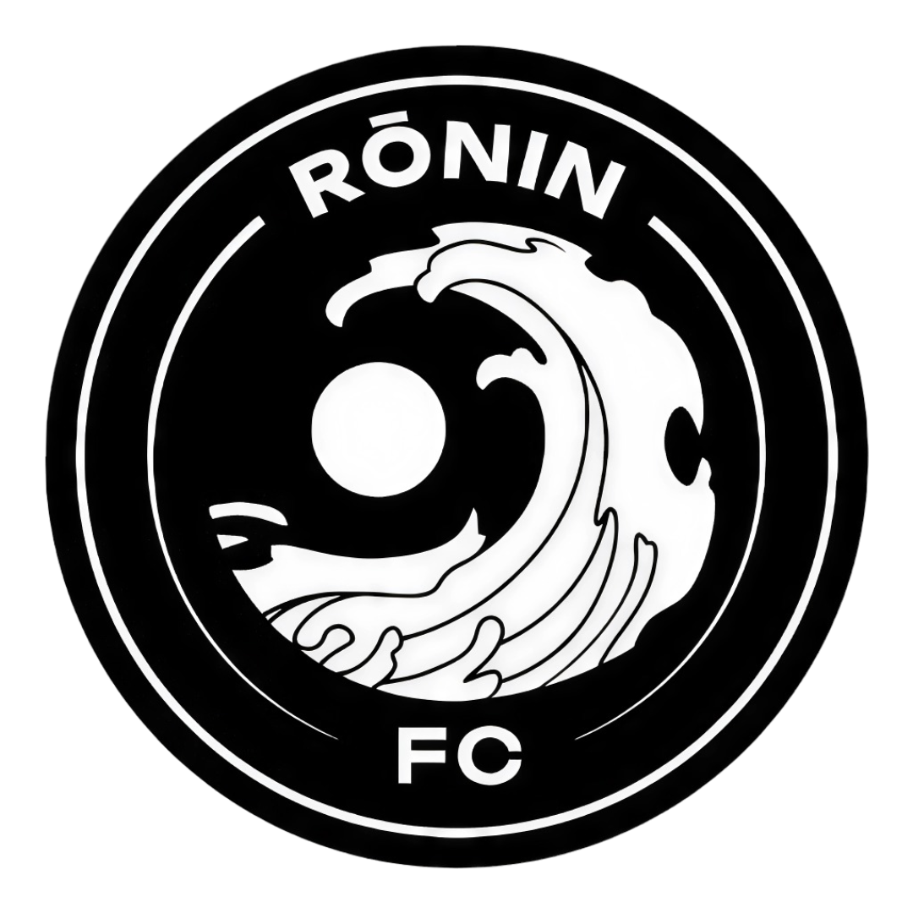

# Rōnin FC - The Official Website

<p align="center">
  
</p>

<h1 align="center">Rōnin FC</h1>

<p align="center">
  <strong>The Spirit of the Warrior, The Heart of the Game</strong>
</p>

<p align="center">
  This is the official web presence for <strong>Rōnin FC</strong>, the fiercest new contender in the Quarta Catalana league. We are more than just a football club; we are a community of warriors, united by passion, discipline, and a relentless drive to win.
</p>

<p align="center">
  <a href="#technologies-used">Technologies</a> •
  <a href="#getting-started">Getting Started</a> •
  <a href="#available-scripts">Scripts</a>
</p>

---

## 🚀 Technologies Used

This website is built and powered by a modern, high-performance stack:

-   **[Next.js](https://nextjs.org/)** - The React Framework for the Web.
-   **[React](https://react.dev/)** - For building dynamic user interfaces.
-   **[TypeScript](https://www.typescriptlang.org/)** - For robust, scalable, and maintainable code.
-   **[Tailwind CSS](https://tailwindcss.com/)** - For a utility-first approach to styling.
-   **[React Fast Marquee](https://www.react-fast-marquee.com/)** - For creating smooth, performant scrolling announcements.
-   **[React Icons](https://react-icons.github.io/react-icons/)** - For including a wide range of icons.

## 🏁 Getting Started

To get a local copy up and running, follow these simple steps.

### Prerequisites

You need to have [Node.js](https://nodejs.org/en) (version 20 or later) and npm installed on your machine.

### Installation

1.  **Clone the repository:**
    ```bash
    git clone <repository-url>
    cd <repository-directory>
    ```
2.  **Install NPM packages:**
    ```bash
    npm install
    ```
3.  **Run the development server:**
    ```bash
    npm run dev
    ```

Open [http://localhost:3000](http://localhost:3000) with your browser to see the result. The page auto-updates as you edit the file.

## 📜 Available Scripts

In the project directory, you can run:

-   `npm run dev`: Runs the app in development mode with Turbopack.
-   `npm run build`: Builds the app for production.
-   `npm run start`: Starts a production server.
-   `npm run lint`: Runs the linter to check for code quality issues.

---

<p align="center">
  <strong>#HolaRoninCatalan</strong>
</p>
